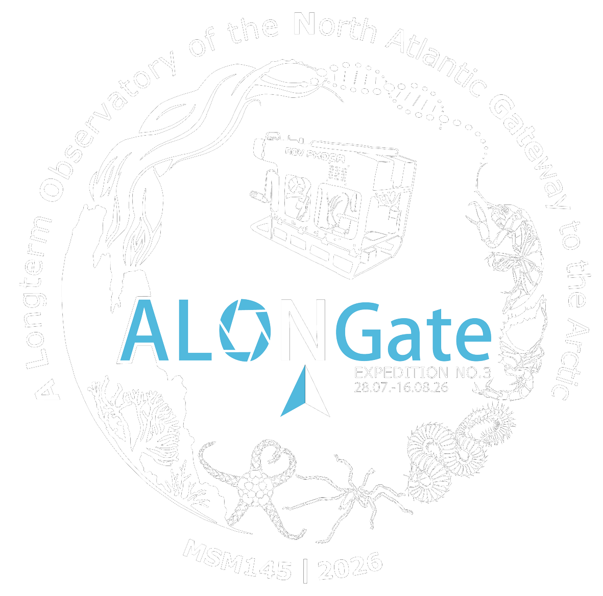

```{=html}
<style>
    body {
        background: linear-gradient(rgba(51, 51, 51, 0.5), rgba(51, 51, 51, 0.5)), url("./assets/img/_ZPA2002.jpg") no-repeat center center fixed;
        background-size: cover;
        font-family: system-ui, -apple-system, 'Segoe UI', Roboto, Helvetica, Arial, sans-serif;
        color: white;
        margin: 0;
        min-height: 100vh;
        display: flex;
        justify-content: center;
        align-items: flex-start;
    }

    .linktree-container {
        width: 100%;
        max-width: 450px;
        padding: 50px 20px;
        text-align: center;
    }

    .profile-pic {
        width: 400px;
        height: 400px;
        border-radius: 50%;
        object-fit: cover;
        border: 3px solid white;
        box-shadow: 0 4px 10px rgba(0,0,0,0.3);
        margin-bottom: 20px;
    }

    .project-title {
        font-size: 2rem;
        font-weight: bold;
        margin-top: 0;
        margin-bottom: 10px;
    }
    .project-desc {
        font-size: 1.1rem;
        margin-bottom: 40px;
        opacity: 0.9;
        line-height: 1.5;
    }

    .link-btn {
        display: flex;
        background-color: rgba(255, 255, 255, 0.15);
        color: white;
        text-decoration: none;
        padding: 8px 20px 8px 12px;
        min-height: 90px;
        margin-bottom: 16px;
        border-radius: 20px;
        font-size: 1.5rem;
        font-weight: 600;
        border: 1px solid rgba(255, 255, 255, 0.3);
        transition: all 0.3s ease;
        backdrop-filter: blur(10px);
        -webkit-backdrop-filter: blur(10px);
    }

    .link-btn:hover, .link-btn:active {
        background-color: white;
        color: #1e3c72;
        transform: translateY(-3px);
        box-shadow: 0 6px 15px rgba(0,0,0,0.2);
    }

    .btn-text {
        display: flex;
        flex-direction: column;
        justify-content: center;
        margin: 0;
        line-height: 1;
    }

    .btn-thumb {
        width: 70px;
        height: 70px;
        border-radius: 14px;
        object-fit: cover;
        margin-right: 20px; /* Space between image and text */
        flex-shrink: 0; /* Prevents the image from shrinking if text is long */
    }
</style>
```

<br><br><br>

::: {.linktree-container}

<!-- Replace 'logo.png' with your actual project logo or a nice icon -->
{.profile-pic}

::: {.project-title}
ALONGate
:::

::: {.project-desc}
<u>**A**</u> <u>**L**</u>ongterm <u>**O**</u>bservatory of the <u>**N**</u>orth Atlantic <u>**Gate**</u>way to the Arctic
:::

```{r}
#| message: false
#| output: asis
#| warning: false
#| echo: false

parse_link <- function(thumb, text) {
    sprintf("[ {.btn-thumb} [%s]{.btn-text}](article-intro.qmd){.link-btn}", thumb, text)
}

thumbs <- c(
    "assets/img/_ZPA2002.jpg",
    "assets/img/_ZPA2002.jpg",
    "assets/img/_ZPA2002.jpg",
    "assets/img/_ZPA2002.jpg",
    "assets/img/_ZPA2002.jpg",
    "assets/img/_ZPA2002.jpg"
)

texts <- c(
    "Background & Aim",
    "BLOS",
    "Cruises",
    "The Macrofauna",
    "The Team",
    "Collaborations"
)

md.parsed <- purrr::map2_chr(thumbs, texts, ~parse_link(.x, .y))

cat(paste(md.parsed, collapse = "\n\n"))
```

:::

```{=html}
<footer style="
    margin-top: 10px;     /* Space between the last button and the footer */
    padding-bottom: 30px;
    font-family: 'Arial', sans-serif; /* Keep Arial for legibility */
    color: #e4dddaff;
    font-weight: 200;
    opacity: 0.8;         /* Slightly brighter */
    text-align: center;    /* Aligns text to the right */
">
<p style="margin: 0; font-size: 0.7rem;">
    Site built with Quarto by <a href="https://zzzhehao.github.io/" style="color: inherit; text-decoration: underline;">Zhehao Hu</a>. 
    Source code available at <a href="https://github.com/zzzhehao/ALONGate_2026_WCMB" style="color: inherit; text-decoration: underline;">github.com</a>.
</p>
</footer>
```